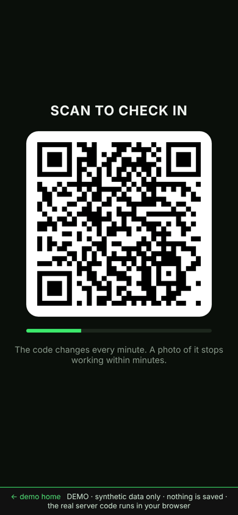
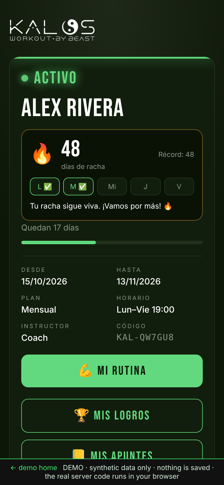
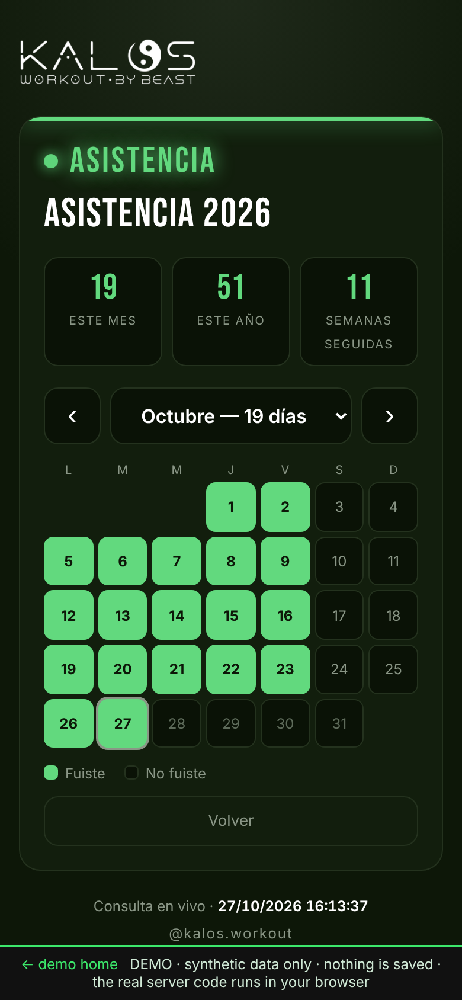
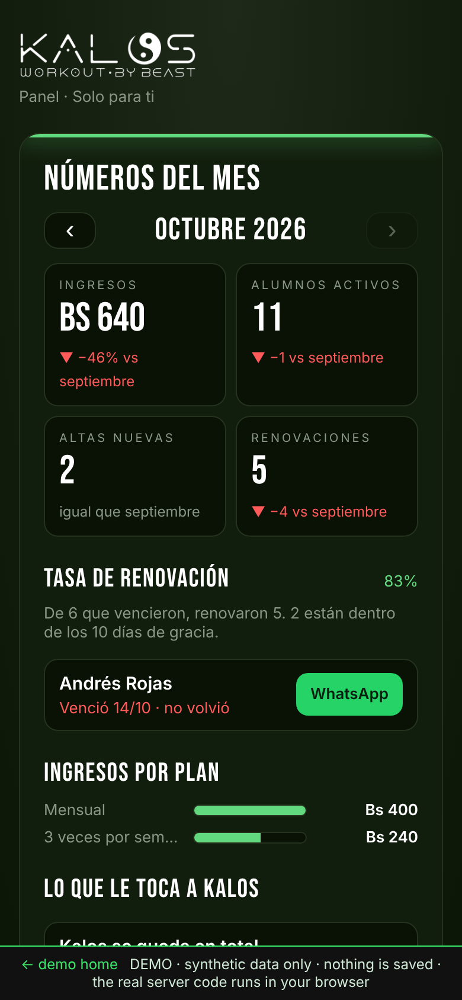
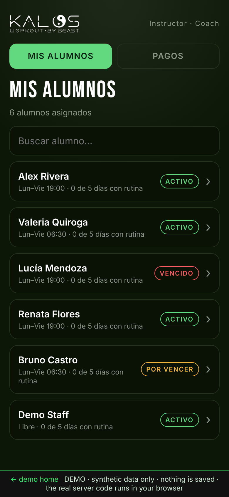
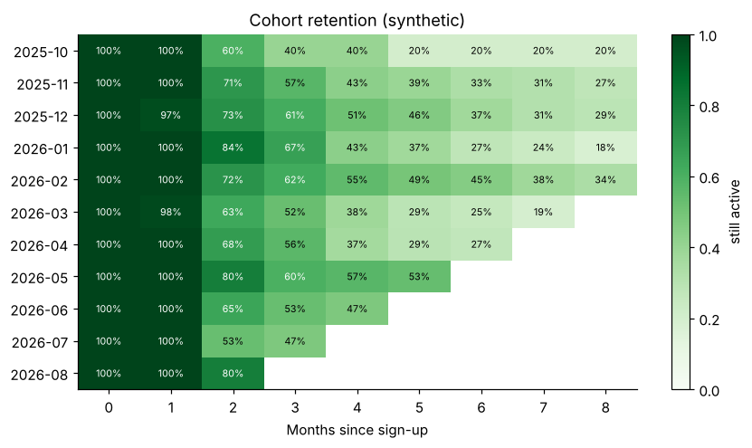
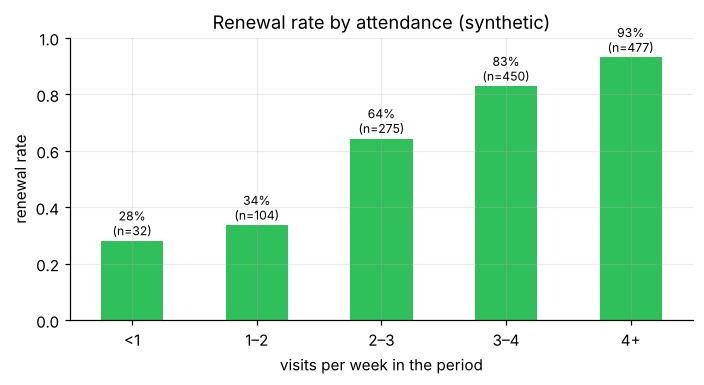

# Kalos Gym System

**A QR membership card, attendance streaks, renewal reminders and an owner dashboard for a calisthenics gym — built on Google Sheets + Apps Script, with an installable PWA front-end.**

[**▶ Live demo**](https://josevargasp99.github.io/kalos-gym-system/) · [Architecture](docs/ARCHITECTURE.md) · [Security notes](docs/SECURITY.md) · [Setup guide](docs/SETUP.md) · [Impact plan](docs/IMPACT.md) · [Retention analysis](analysis/retention_analysis.ipynb)

Built by **José E. Vargas Pedrazas**, Operations Manager at Kalos (Cochabamba, Bolivia) — [LinkedIn](https://www.linkedin.com/in/jose-vargas-dataanalyst) · [GitHub](https://github.com/josevargasp99)

<p align="center"></p>

> **Resumen en español:** sistema que usamos en Kalos Calistenia (Cochabamba) para reemplazar la lista en papel: cada alumno tiene una tarjeta con QR y una app instalable que muestra su estado, su racha de asistencia, su calendario, sus metas y un botón de renovación. El dueño ve números del mes, tasa de renovación y reparto de ingresos. Esta es una edición para portafolio: sin datos reales, con datos sintéticos en la demo y con mejoras de seguridad. Lanzado el **26/10/2026**; el impacto se mide durante 3 meses (hasta el 26/01/2027).

---

## The problem
A small gym tracked memberships on paper and WhatsApp: nobody knew who was about to expire, who had quietly stopped coming, or what the month actually earned. Renewals depended on someone remembering to ask.

## What it does

| For members | For the instructor | For the owner |
|---|---|---|
| QR card with live status (active / expiring / expired) | Own student list and training notes | Monthly revenue, sign-ups, renewals, **renewal rate** with a grace window |
| Attendance check-in at the door and yearly calendar | Weekly routine images per student | Who did not come back (one tap to WhatsApp) |
| **Streaks** (business days only, holidays respected) | Weekly payout calculation | Revenue split between gym, space partner and coach |
| Goals checklist, training notes | | New sign-ups, renewals, trial accounts |
| **Push reminders** (3 days before, on the day, after expiry) with +2 bonus days for early renewal | | Attendance by weekday / hour |

<p align="center">
   
</p>

## Technical highlights
- **No servers, no monthly cost:** Google Sheets is the database; Apps Script is the API; GitHub Pages hosts the PWA.
- **Web Push implemented by hand inside Apps Script.** VAPID with ES256 (ECDSA P-256) written in pure JS with deterministic nonces (RFC 6979), because Apps Script has no WebCrypto. The push carries no payload; the service worker fetches the message when it arrives. → [`13-push-notifications.gs`](apps-script/13-push-notifications.gs)
- **Presence proof at the door:** check-in requires a QR that rotates every minute (HMAC of a time window), so a photo of the code stops working in minutes. → [`04-attendance-and-door.gs`](apps-script/04-attendance-and-door.gs), [`Door.html`](apps-script/Door.html)
- **Streak engine** with business-day rules, holidays, a 3×/week mode and a "penance" restore the owner can grant. → [`10-streak.gs`](apps-script/10-streak.gs)
- **Defense in depth on a public endpoint:** per-person and global rate limits, constant-time key comparison, script locks around writes, spreadsheet-formula injection stripped from user text, strict output encoding (text nodes only, no `innerHTML` with user data).
- **QR codes generated locally** (bundled library) so a member's card code never goes to a third-party QR service.
- **The demo runs the real server code.** A ~200-line Apps Script emulator backs the real `.gs` files with an in-memory sheet, so the live demo exercises the same logic as production. → [`demo/`](demo/)
- **Analytics-ready:** the data model (students, renewals, attendance) feeds a cohort/retention notebook. → [`analysis/`](analysis/retention_analysis.ipynb)

<p align="center"> </p>

## Impact (measurement in progress)
Launched **26 Oct 2026**. Results will be measured over the first **3 months (closing 26 Jan 2027)** and published here; nothing below is claimed as achieved yet.

| KPI | How it is measured | Source |
|---|---|---|
| Active members | Members with a valid paid period, month over month | `Alumnos`, `Renovaciones` |
| App adoption | % of active members who check in through the app/QR | `Asistencia` |
| Renewal rate | Periods followed by a new one within 10 days | owner panel / notebook |
| Reminders enabled | Members with push reminders on | `Avisos` |
| Admin time saved | Estimated hours per day on renewals, reminders and attendance (operator estimate, documented method) | time log |

The operator's initial expectations (to be tested, not results): more active members, near-universal app adoption, a higher renewal rate and at least an hour of admin time saved per day. Details and caveats in [`docs/IMPACT.md`](docs/IMPACT.md).

## Repository map
```
apps-script/   Server code (.gs modules), HTML Service pages (owner panel, door screen, fallback page)
web/           Member PWA (index.html, service worker, manifest) and instructor app (coach.html)
demo/          Apps Script emulator, synthetic seed data and the demo builder
docs/          Built static demo (GitHub Pages) + architecture, security, setup, impact notes
analysis/      Synthetic data generator and the retention-analysis notebook
tools/         VAPID key generator
tests/         Security regression tests (door code, admin guards, rate limits)
```

## Run the demo locally
```bash
node demo/build.js            # rebuilds docs/ from apps-script/, web/ and demo/
python3 -m http.server 8000 -d docs
node tests/security.test.js   # door-code, admin-guard and rate-limit checks
```

## About this edition
This is a **sanitized portfolio edition** of a system running in production at Kalos. All member data, phone numbers, payment details, partner names, deployment URLs and keys were removed or replaced with placeholders; the demo uses invented people. It also includes the hardening described in [`docs/SECURITY.md`](docs/SECURITY.md). The Kalos name and logos belong to their owners and appear here only to illustrate the project.

## Related
A companion project, **Kalo** — an AI agent built with n8n for the same gym — handles lead capture and content automation.

## License
All rights reserved — see [LICENSE](LICENSE). Third-party: qrcode-generator (MIT).
