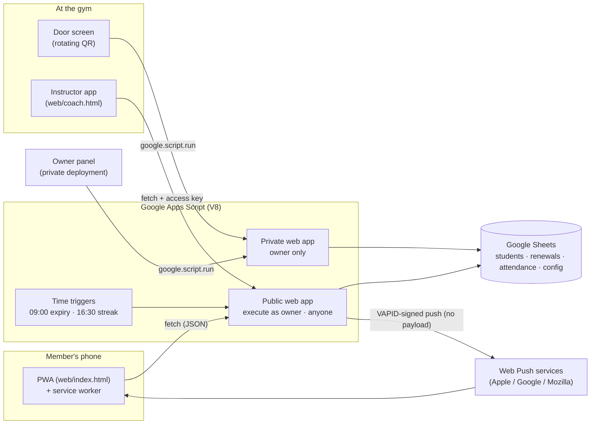

# Architecture

## Why this shape
- **Zero infrastructure.** The gym already lived in a spreadsheet; keeping it as the system of record means the owner can read and fix data without a developer.
- **Two deployments of the same script.** The *public* web app (anonymous access) serves cards and check-ins. The *private* one (owner only) serves the dashboard and the door screen; owner-only functions also verify the caller's identity in code.
- **Static front-end.** The PWA is plain HTML/JS on GitHub Pages and talks to Apps Script with `fetch`. User data is only ever written with `textContent`.

## Server modules (`apps-script/`)
| File | Responsibility |
|---|---|
| `01-config-and-menu.gs` | Settings (`CFG`), sheet menu |
| `02-web-app.gs` | `doGet` / `doPost` routing, public lookup |
| `03-goals.gs` | Member goals (3 per round) |
| `04-attendance-and-door.gs` | Check-in, calendar, **rotating door code** |
| `05-owner-panel.gs` | Owner dashboard: numbers, students, sign-ups, renewals |
| `06-cards-and-links.gs` | PDF card generation from a Slides template, shareable link |
| `07-config-and-utils.gs` | Config sheet access, IDs, helpers |
| `08-coach-routines.gs` | Instructor access and routine images |
| `09-coach-payments.gs` | Revenue split and weekly coach payouts |
| `10-streak.gs` | Streak engine (business days, holidays, 3×/week mode, restore) |
| `11-physio.gs` | Counts referrals to a partner physiotherapist |
| `12-notes.gs` | Members' training notes |
| `13-push-notifications.gs` | ES256/VAPID push, reminder scheduling, queue |
| `Qr.gs` | Bundled QR generator (MIT) |

Apps Script loads every `.gs` file into one global scope, so file order only matters for top-level constants that depend on each other (the numeric prefixes keep the original order).

## Data model (sheets)
`Alumnos` (students) · `Renovaciones` (payments: id, dates, plan, amount, type, instructor) · `Asistencia` (date, time, id) · `Logros` · `Apuntes` · `Rutinas` · `Avisos` / `Avisos cola` (push devices and queue) · `Pagos Coach` · `Rachas` (restores) · `Fisio` · `Config` (key/value).

## Notifications flow
1. The member taps *Enable reminders*; the browser creates a push subscription and the endpoint is stored (max 3 devices per member, host allow-list).
2. At 09:00 / 16:30 a time trigger decides who gets what, queues the message and sends an **empty, VAPID-signed push**.
3. The service worker wakes up, asks the server for the queued message and shows it; tapping opens the renewal screen.

## The demo
`demo/gas-emulator.js` re-implements only the Apps Script services this project touches (Spreadsheet, Cache, Lock, Properties, Utilities incl. SHA-256/HMAC) on in-memory data. `demo/build.js` concatenates the emulator, the real `.gs` files and a seed into `docs/assets/server.js`; `fetch` and `google.script.run` are routed to it.
